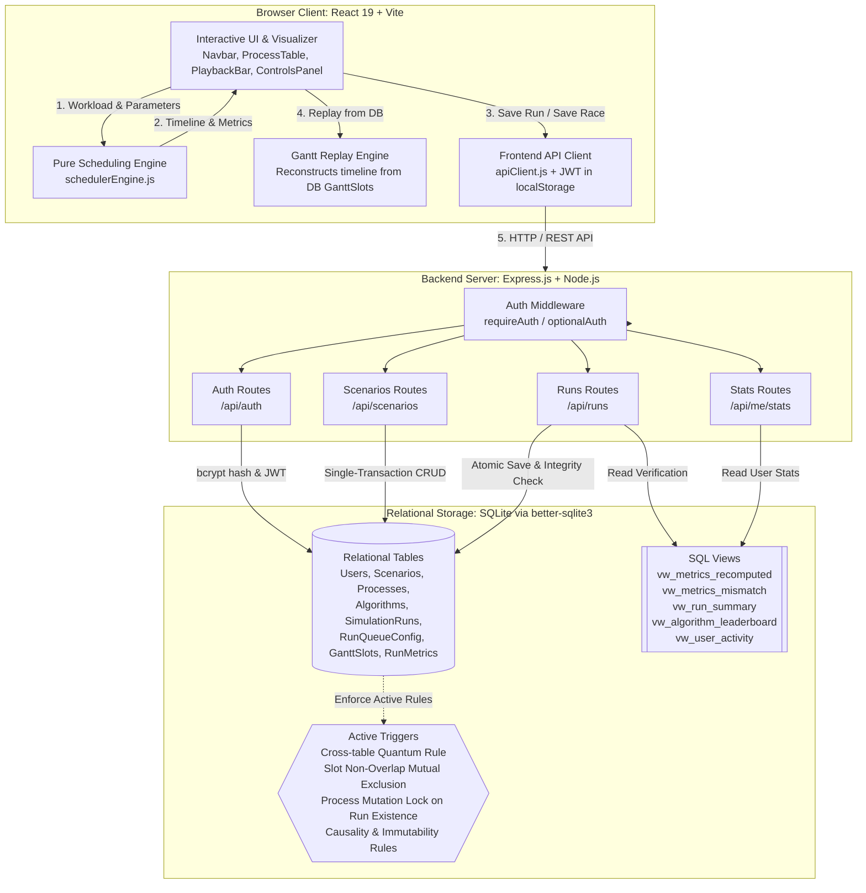
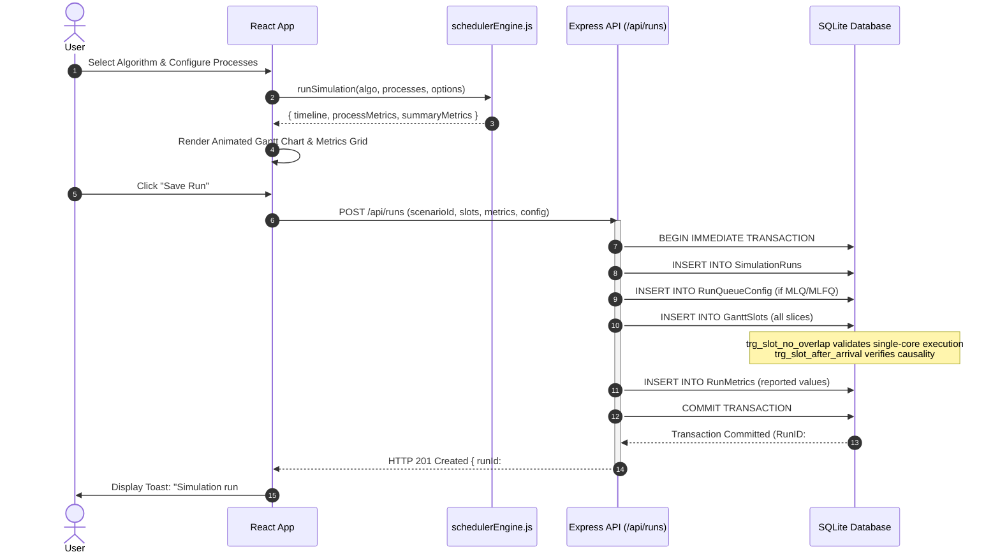
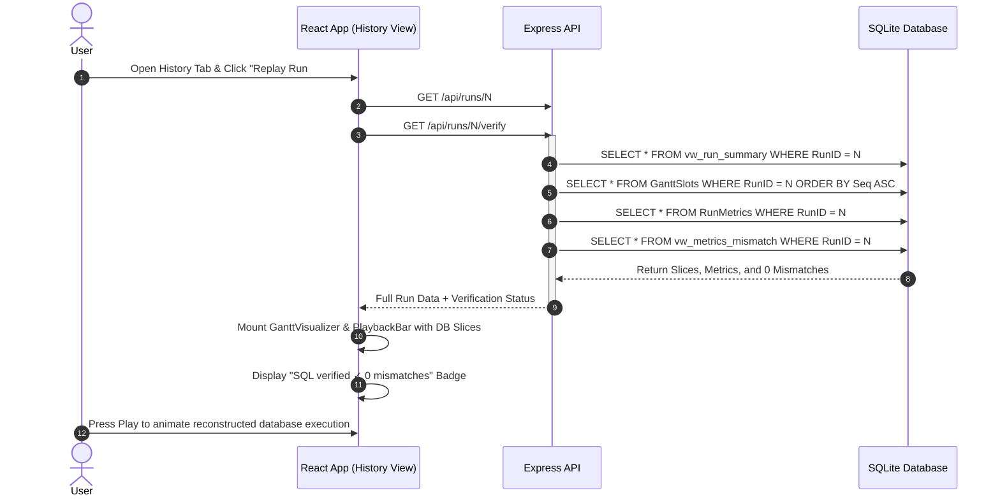

# SyncFlow Database — System Architecture & Component Design

This document details the software architecture, data flow patterns, and component interactions of **SyncFlow + Database**. It explains the dual-mode operation (Guest Mode vs. Logged-in Mode) and illustrates how the frontend React visualizer, the pure scheduling engine, the Node.js API, and the SQLite relational database collaborate.

---

## 1. System Topology & Architecture Diagram



---

## 2. Dual-Mode Operation: Guest Mode vs. Logged-in Mode

A core design requirement of the PBL specification is that **Guest Mode must remain 100% functional without a backend or database**. SyncFlow achieves this through strict decoupling between the simulation visualizer and the persistence layer.

```
                    ┌───────────────────────────────────────────────┐
                    │               SyncFlow Client                 │
                    └───────────────────────┬───────────────────────┘
                                            │
                     Is User Authenticated & Server Online?
                                            │
                         ┌──────────────────┴──────────────────┐
                         ▼                                     ▼
                  [ NO (Guest Mode) ]                 [ YES (Logged-in Mode) ]
            ┌────────────────────────────┐      ┌──────────────────────────────────┐
            │ • Pure in-browser engine   │      │ • All Guest Mode capabilities    │
            │ • Textbook presets loading │      │ • Relational Scenario persistence│
            │ • Random workload generator│      │ • Single-run database saving     │
            │ • Live animated Gantt chart│      │ • Multi-algorithm Race Mode saves│
            │ • Race Mode comparison     │      │ • Replay past Gantt runs from DB │
            │ • JSON export & import     │      │ • Independent SQL verification   │
            │ • Zero backend dependency  │      │ • SQL Window Function leaderboard│
            │ • Static build deployable  │      │ • User activity & aggregate stats│
            └────────────────────────────┘      └──────────────────────────────────┘
```

### 2.1 Guest Mode (Offline & Unauthenticated)
- **Zero Network Requirement:** Operates completely client-side in the browser. If the backend server is stopped or unreachable, SyncFlow displays an unobtrusive `offline — guest mode` indicator in the navbar and continues normal operation without modal blocking or network error alerts.
- **Pure Functional Simulation:** Invokes `runSimulation(algorithm, processes, options)` synchronously in the browser.
- **Client-Side Storage & Portability:** Workloads can be exported as `.json` files or printed as high-resolution PDF simulation reports via `ExportModal`.

### 2.2 Logged-in Mode (Authenticated with Relational Database)
- **Identity & Security:** Secure token-based authentication using JSON Web Tokens (7-day expiry) and bcrypt password hashing with salt rounds 10.
- **Scenario Management:** Users can persist workload configurations to SQLite, browse public community scenarios, fork/duplicate workloads, and import JSON files directly into their relational database account.
- **Database Replay (No Re-simulation):** Opening a saved run in the History tab reconstructs the exact animated Gantt chart and process metrics table directly from stored `GanttSlots` and `RunMetrics` records without re-running the scheduling algorithm.
- **SQL Audit & Integrity:** Evaluates the database view `vw_metrics_mismatch` on demand, providing a `SQL verified ✓ 0 mismatches` badge.
- **Leaderboards & Window Functions:** Computes dynamic algorithm rankings per scenario via `vw_algorithm_leaderboard` using `RANK() OVER (PARTITION BY ScenarioID ORDER BY AvgWT)`.

---

## 3. Data Flow Sequences

### 3.1 Simulation and Atomic Persistence Flow



---

### 3.2 Database Replay and Independent SQL Verification Flow



---

## 4. Key Design Decisions

1. **Pure Engine Portability:** The scheduling logic in `src/engine/schedulerEngine.js` contains **zero React, DOM, or Node-specific dependencies**. This allows the exact same scheduling code to run in the Vite browser client during live simulation and inside Node.js scripts (`server/db/seed_demo.js` and test suites).
2. **Transaction Atomicity:** All writes affecting multiple tables (e.g. Scenarios + Processes, or Run Header + Queue Config + Slots + Metrics) are wrapped in atomic SQLite transactions. If a single trigger or constraint fails, all partial state is rolled back.
3. **No ORM (Handwritten SQL):** All database interactions use direct SQL statements and prepared statements (`better-sqlite3`), allowing fine-grained control over query plans, CTEs, triggers, and window functions.
