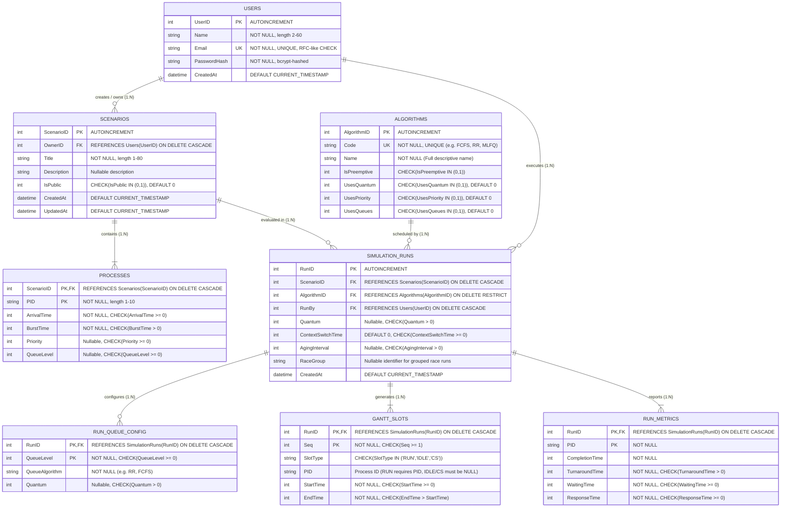

# SyncFlow Database — Entity-Relationship (ER) Diagram

This document presents the complete relational data model for **SyncFlow + Database**. It specifies all entities, attributes, constraints, primary keys, foreign keys, and relational cardinalities.

---

## 1. Mermaid Entity-Relationship Diagram

---

## 2. Relational Cardinalities and Referential Actions

| Parent Entity | Child Entity | Foreign Key | Cardinality | ON DELETE | ON UPDATE | Concept & Business Rule |
|---|---|---|---|---|---|---|
| **Users** | **Scenarios** | `Scenarios.OwnerID` | $1 : N$ (Zero or More) | `CASCADE` | `NO ACTION` | A user can own multiple workload scenarios; deleting an account cascades to all owned scenarios. |
| **Users** | **SimulationRuns** | `SimulationRuns.RunBy` | $1 : N$ (Zero or More) | `CASCADE` | `NO ACTION` | A user can execute multiple simulation runs; deleting an account removes their run history. |
| **Scenarios** | **Processes** | `Processes.ScenarioID` | $1 : N$ (One or More) | `CASCADE` | `NO ACTION` | Weak entity / composition: a scenario comprises 1 to $N$ processes; deleting a scenario cascades to its process list. |
| **Scenarios** | **SimulationRuns** | `SimulationRuns.ScenarioID` | $1 : N$ (Zero or More) | `CASCADE` | `NO ACTION` | A scenario serves as the input specification for zero or more simulation runs. |
| **Algorithms** | **SimulationRuns** | `SimulationRuns.AlgorithmID` | $1 : N$ (Zero or More) | `RESTRICT` | `NO ACTION` | Lookup dimension: an algorithm cannot be deleted if historical simulation runs reference it. |
| **SimulationRuns** | **RunQueueConfig** | `RunQueueConfig.RunID` | $1 : N$ (Zero or More) | `CASCADE` | `NO ACTION` | Decomposed multi-valued attribute: MLQ/MLFQ multi-level queue configurations are tied to a specific run. |
| **SimulationRuns** | **GanttSlots** | `GanttSlots.RunID` | $1 : N$ (One or More) | `CASCADE` | `NO ACTION` | Chronological time slices of CPU execution: deleting a run removes all of its time slices. |
| **SimulationRuns** | **RunMetrics** | `RunMetrics.RunID` | $1 : N$ (One or More) | `CASCADE` | `NO ACTION` | Per-process execution performance summary: deleting a run removes all associated process metrics. |

---

## 3. Key Constraints & Candidate Keys

1. **`Users`**:
   - Primary Key: `UserID`
   - Candidate Key: `Email` (`UNIQUE`)
   - Check Constraints: `length(Name) BETWEEN 2 AND 60`, `Email LIKE '%_@_%._%'`
2. **`Scenarios`**:
   - Primary Key: `ScenarioID`
   - Composite Candidate Key: `(OwnerID, Title)` (`UNIQUE`) — A single user cannot have duplicate scenario titles.
   - Check Constraints: `length(Title) BETWEEN 1 AND 80`, `IsPublic IN (0,1)`
3. **`Processes`**:
   - Composite Primary Key: `(ScenarioID, PID)` — Each process is uniquely identified within its scenario.
   - Check Constraints: `length(PID) BETWEEN 1 AND 10`, `ArrivalTime >= 0`, `BurstTime > 0`, `Priority >= 0`, `QueueLevel >= 0`
4. **`Algorithms`**:
   - Primary Key: `AlgorithmID`
   - Candidate Key: `Code` (`UNIQUE`) — System code (`FCFS`, `SJF`, `SRTF`, `PRIORITY_NP`, `PRIORITY_P`, `RR`, `MLQ`, `MLFQ`).
   - Check Constraints: Boolean domain checks (`IN (0,1)`) on capability flags.
5. **`SimulationRuns`**:
   - Primary Key: `RunID`
   - Foreign Keys: `ScenarioID`, `AlgorithmID`, `RunBy`
   - Check Constraints: `Quantum > 0`, `ContextSwitchTime >= 0`, `AgingInterval > 0`
6. **`RunQueueConfig`**:
   - Composite Primary Key: `(RunID, QueueLevel)` — Prevents duplicate queue levels within a single run.
   - Check Constraints: `QueueLevel >= 0`, `Quantum > 0`
7. **`GanttSlots`**:
   - Composite Primary Key: `(RunID, Seq)` — Slices are numbered in strictly ascending chronological order starting at 1.
   - Check Constraints: `Seq >= 1`, `SlotType IN ('RUN','IDLE','CS')`, `StartTime >= 0`, `EndTime > StartTime`, conditional PID requirement (`RUN` must have PID; `IDLE`/`CS` must have `NULL` PID).
8. **`RunMetrics`**:
   - Composite Primary Key: `(RunID, PID)` — Redundant storage of engine metrics per process for independent SQL verification.
   - Check Constraints: `TurnaroundTime > 0`, `WaitingTime >= 0`, `ResponseTime >= 0`
